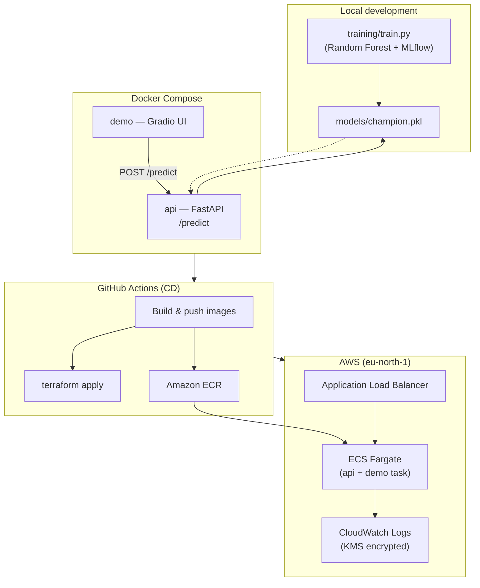

# California House Price Prediction — MLOps & DevOps Portfolio Project

[](https://github.com/yRagax/devops-learning/actions/workflows/ci.yaml)
[](https://github.com/yRagax/devops-learning/actions/workflows/cd.yaml)

An end-to-end machine learning project that trains a regression model, serves it through a REST API, exposes a web demo, and deploys the full stack to AWS with Docker, GitHub Actions, and Terraform.

Built as a **self-directed learning project** to practice the full MLOps lifecycle — from experiment tracking and model packaging to containerized delivery and cloud infrastructure.

---

## What This Project Demonstrates

| Area | Skills & tools |
|------|----------------|
| **Machine Learning** | scikit-learn, hyperparameter search, model serialization, California Housing dataset |
| **MLOps** | MLflow experiment tracking, reproducible training runs, champion model promotion |
| **Backend** | FastAPI, Pydantic validation, OpenAPI docs |
| **Frontend / Demo** | Gradio interactive UI calling the inference API |
| **Containers** | Multi-service Docker Compose, slim Python images, ECR image registry |
| **CI/CD** | GitHub Actions — pytest on PRs, build/push/deploy on merge to `main` |
| **Cloud (AWS)** | ECS Fargate, Application Load Balancer, VPC networking, IAM roles, KMS-encrypted logs |
| **Infrastructure as Code** | Terraform modules for VPC, security groups, ECS, ALB, CloudWatch, VPC Flow Logs |
| **Testing** | Unit tests for API validation and demo client behavior (pytest, TestClient, mocking) |

---

## Architecture



**Request flow in production:** Users interact with the Gradio demo via the ALB demo port → the demo container calls the API container on `/predict` → the API loads the serialized Random Forest model and returns a predicted median house value.

---

## Tech Stack

- **Language:** Python 3.12
- **ML:** scikit-learn, MLflow, pandas
- **API:** FastAPI, Uvicorn, Pydantic
- **UI:** Gradio
- **Containers:** Docker, Docker Compose
- **CI/CD:** GitHub Actions, OIDC / AWS credentials
- **Cloud:** AWS ECS Fargate, ECR, ALB, VPC, IAM, KMS, CloudWatch
- **IaC:** Terraform (S3 remote state backend)

---

## Project Structure

```
devops-learning/
├── api/                  # FastAPI inference service
│   ├── api.py
│   ├── schemas.py
│   ├── Dockerfile
│   └── requirements.txt
├── demo/                 # Gradio web interface
│   ├── demo.py
│   ├── Dockerfile
│   └── requirements.txt
├── training/             # Model training with MLflow
│   ├── train.py
│   └── requirements.txt
├── models/               # Serialized champion model (champion.pkl)
├── tests/                # pytest suite
├── terraform/            # AWS infrastructure (VPC, ECS, ALB, IAM, logging)
├── .github/workflows/    # CI (PR tests) and CD (build, push, deploy)
├── compose.yaml          # Multi-container local/production image build
├── .env.example          # Application environment template
└── .secrets.example      # AWS credentials template (local CD only)
```

---

## Getting Started

### Prerequisites

- Python 3.12+
- Docker & Docker Compose
- (Optional) AWS account, Terraform ≥ 1.x, and an MLflow tracking server for training

### 1. Clone and configure environment

```bash
git clone https://github.com/yRagax/devops-learning.git
cd devops-learning
cp .env.example .env
```

Edit `.env` with your values:

| Variable | Description |
|----------|-------------|
| `MLFLOW_URI` | MLflow tracking server URI (training only) |
| `API_PORT` | Port for the FastAPI service (e.g. `8000`) |
| `DEMO_PORT` | Port for the Gradio demo (e.g. `7860`) |
| `MODEL_PATH` | Path to the model file (e.g. `models/champion.pkl`) |
| `ECR_REPOSITORY` | ECR repository name (Docker/CD only) |
| `AUDIENCE` | AWS OIDC audience (CD pipeline only) |

### 2. Install dependencies (local development)

```bash
python3 -m venv .venv
source .venv/bin/activate
pip install -r api/requirements.txt -r demo/requirements.txt -r tests/requirements.txt
```

### 3. Run the API locally

```bash
python3 -B -m api.api
```

Open the interactive API docs at `http://localhost:<API_PORT>/docs`.

### 4. Run the Gradio demo

In a second terminal:

```bash
python3 -B -m demo.demo
```

Open `http://localhost:<DEMO_PORT>` and submit sample housing features to get a prediction.

---

## Model Training

The training script performs a grid search over Random Forest hyperparameters and logs every run to MLflow (parameters, metrics, and model artifacts).

```bash
pip install -r training/requirements.txt
python3 -B training/train.py
```

After selecting the best run in MLflow, export the champion model to `models/champion.pkl` for use by the API.

---

## Docker

Build and run both services with Docker Compose:

```bash
docker compose up --build
```

Both containers use host networking so the demo can reach the API at `localhost:<API_PORT>`.

---

## Testing

```bash
PYTHONDONTWRITEBYTECODE=1 python3 -m pytest -p no:cacheprovider
```

Tests cover:

- Successful inference and expected output values
- Pydantic validation errors (invalid types, missing fields)
- Demo client behavior (success, HTTP errors, connection failures)

CI runs the same test suite automatically on every pull request to `main`.

---

## CI/CD Pipelines

### Continuous Integration (`.github/workflows/ci.yaml`)

Triggered on **pull requests** to `main`:

1. Set up Python 3.12
2. Install dependencies
3. Run `pytest` with repository variables for ports and model path

### Continuous Deployment (`.github/workflows/cd.yaml`)

Triggered on **push to `main`**:

1. Authenticate to AWS (OIDC role preferred; access keys as fallback)
2. Log in to Amazon ECR
3. Build and push `api` and `demo` Docker images (tagged with commit SHA + `latest`)
4. Run `terraform apply` to update ECS task definitions and roll out new images

---

## AWS Infrastructure (Terraform)

Infrastructure is defined under `terraform/` and includes:

- **Networking:** VPC, public subnets across 3 AZs, Internet Gateway, route tables
- **Compute:** ECS Fargate cluster and service with a multi-container task (API + demo)
- **Load balancing:** Application Load Balancer with separate target groups and listeners per service
- **Security:** Security groups restricting ECS ingress to ALB only; configurable ALB ingress CIDR
- **Observability:** CloudWatch log groups with KMS encryption, VPC Flow Logs
- **IAM:** ECS task execution and task roles, VPC Flow Logs role

### Deploy manually

```bash
cp terraform/terraform.tfvars.example terraform/terraform.tfvars
# Edit terraform.tfvars with your port and model path values

terraform -chdir=terraform init
terraform -chdir=terraform plan \
  -var "api_container_port=<API_PORT>" \
  -var "demo_container_port=<DEMO_PORT>" \
  -var "model_path=<MODEL_PATH>"
terraform -chdir=terraform apply \
  -var "api_container_port=<API_PORT>" \
  -var "demo_container_port=<DEMO_PORT>" \
  -var "model_path=<MODEL_PATH>"
```

After apply, Terraform outputs the ALB DNS name and service URLs:

```bash
terraform -chdir=terraform output demo_url
terraform -chdir=terraform output api_url
```

> **Note:** The Terraform backend uses a remote S3 state bucket. You will need appropriate AWS credentials and may need to adjust the backend configuration for your own account.

---

## API Reference

**`POST /predict`**

Request body (JSON):

```json
{
  "longitude": -122.23,
  "latitude": 37.88,
  "housing_median_age": 41.0,
  "total_rooms": 880.0,
  "total_bedrooms": 129.0,
  "population": 322.0,
  "households": 126.0,
  "median_income": 8.3252
}
```

Response:

```json
{
  "prediction": 4.526
}
```

Interactive documentation is available at `/docs` when the API is running.

---

## Security Notes

- Never commit `.env`, `.secrets`, or real AWS credentials — use the provided `.example` templates.
- Restrict `allowed_ingress_cidr` in Terraform to your IP range before exposing the ALB publicly.
- The CD pipeline supports **OIDC federation** (recommended) to avoid long-lived access keys in GitHub Secrets.

---

## Future Improvements

- [ ] Add HTTPS/TLS termination (ACM certificate on ALB)
- [ ] Store model artifacts in S3 and load at runtime instead of baking into the image
- [ ] Add monitoring dashboards and alerting (CloudWatch alarms)
- [ ] Introduce staging environment with separate Terraform workspace
- [ ] Automate champion model selection from MLflow in the training pipeline

---

## Author

**yRagax** — [GitHub](https://github.com/yRagax)

Self-directed DevOps & MLOps learning project. Feedback and suggestions are welcome via [Issues](https://github.com/yRagax/devops-learning/issues).

---

## License

This project is licensed under the MIT License — see [LICENSE](LICENSE) for details.
